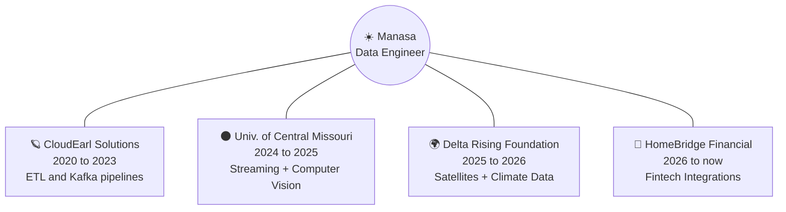

<div align="center">


<a href="https://linkedin.com/in/jami-manasa"></a>
<a href="https://drive.google.com/file/d/1W8EMrbzI3u9vHxy8zxEINOaq7dXYN5fd/view?usp=sharing"></a>


</div>

---

## 🌌 Origin Story


In the beginning there was raw data: messy, scattered, and silent.

I'm **Manasa**, a **Data Engineer with 4+ years** of experience. I build the forces that pull scattered data together into something people can actually use: pipelines, streaming systems, and ML-powered analytics.

```text
🛰️  Home base   : USA
🌍  Launched    : Odisha, India
🎓  Training    : M.S. Computer Science, University of Central Missouri
📡  Signal      : Production Support Engineer, keeping enterprise
                  mortgage systems in stable orbit
```

---

## 🪐 My Solar System



---

## 🛸 Flight Log

```text
╔══════════════════════════════════════════════════════════════════╗
║  MISSION CONTROL :: CAREER TRAJECTORY                            ║
╚══════════════════════════════════════════════════════════════════╝

🪐 PLANET 1  CloudEarl Solutions          [2020-03 → 2023-05]
   ├─ PySpark + Kafka pipelines moving 100K+ records a day
   ├─ dbt + Snowflake models with data quality checks
   └─ multi-cloud cost optimization platform
   STATUS: ✅ orbit completed

🌑 PLANET 2  Univ. of Central Missouri    [2024-08 → 2025-05]
   ├─ Spark Streaming pipelines feeding YOLOv8 models
   ├─ cut inference latency by 40%
   └─ Snowflake-ready ETL workflows
   STATUS: ✅ orbit completed

🌍 PLANET 3  Delta Rising Foundation      [2025-07 → 2026-05]
   ├─ LiDAR + Sentinel satellite imagery into scalable ETL
   ├─ carbon stock models with XGBoost + Random Forest
   └─ geospatial dashboards mapping carbon density
   STATUS: ✅ orbit completed

🚀 PLANET 4  HomeBridge Financial         [2026-06 → now]
   ├─ debug and support enterprise loan platform integrations
   ├─ .NET APIs, SQL, Python, Azure Service Bus
   └─ third-party data integrations
   STATUS: 🟢 currently in orbit
```

---

## ☄️ Missions Launched

<table>
<tr>
<td width="33%" valign="top">

### 🔭 Mission: Watchtower
**Smart Traffic Analytics**
`Spark Streaming` `YOLOv8` `Chart.js`

Scanned 200+ hours of camera footage in real time to track foot traffic and dwell time for ad placement.

</td>
<td width="33%" valign="top">

### 🌠 Mission: Gravity Well
**Cloud Cost Optimizer**
`Python` `Boto3` `CloudWatch`

Pulled idle EC2/RDS resources offline on a schedule and forecasted spend. Cut monthly compute cost by ~60%.

</td>
<td width="33%" valign="top">

### 🛰️ Mission: Signal
**MuleConnect + GenAI**
`Django` `MongoDB Atlas` `AWS` `LLMs`

Alumni-student community platform with a multilingual AI chatbot, deployed on AWS.

</td>
</tr>
</table>

---

## ✨ Constellations I Navigate By

<div align="center">

</div>

```yaml
⭐ Language Nebula      : [Python, SQL, PySpark, Java, Bash, C#]
🌌 Pipeline Galaxy      : [Airflow, dbt, Spark Streaming, Kafka, Databricks, Hadoop]
🪐 Storage Planets      : [Snowflake, Redshift, PostgreSQL, MySQL, MongoDB]
☁️ Cloud Belt           : [AWS, Azure, GCP]
🧠 Intelligence Cluster : [TensorFlow, XGBoost, YOLO, Hugging Face, RAG, FAISS, Pinecone]
🛠️ Launch Systems       : [Docker, Kubernetes, Jenkins, GitLab CI/CD]
🔭 Observatories        : [Tableau, Power BI, Plotly Dash]
```

---

## 📡 Incoming Transmission

- 🔭 **Exploring:** deeper Databricks internals (writing a LinkedIn series on it)
- 🤝 **Open to:** data engineering roles and pipeline-heavy problems
- 💬 **Ask me about:** streaming pipelines, Snowflake modeling, cutting cloud bills

---

<div align="center">

```text
🌌  The universe is made of data. I just build the gravity.  🌌
```


</div>
