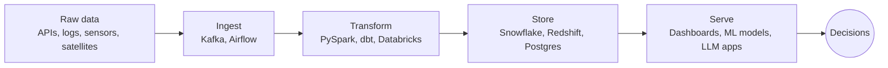

<div align="center">


<a href="https://linkedin.com/in/jami-manasa"></a>
<a href="https://drive.google.com/file/d/1W8EMrbzI3u9vHxy8zxEINOaq7dXYN5fd/view?usp=sharing"></a>


</div>

---

### `> SELECT * FROM engineers WHERE name = 'Manasa Jami';`


| column | value |
|---|---|
| `role` | Data Engineer |
| `experience_years` | 4+ |
| `currently` | Production Support Engineer, keeping enterprise mortgage systems running (SQL, Python, APIs, cloud) |
| `builds` | ETL/ELT pipelines, streaming systems, ML-backed analytics |
| `domains` | Fintech, climate tech, computer vision |
| `education` | M.S. Computer Science, University of Central Missouri |
| `based_in` | Atlanta, USA |

`1 row returned`

---

### How I think about data



Most people see the dashboard. I build everything to the left of it.

---

### Career run log

```text
$ cat career.log

[2020-03 → 2023-05]  CloudEarl Solutions        Data Engineer
    ├─ PySpark + Kafka ETL pipelines processing 100K+ records/day
    ├─ dbt + Snowflake data models with governance checks
    └─ multi-cloud cost optimization platform        status=SUCCESS

[2024-08 → 2025-05]  Univ. of Central Missouri  Graduate Research Assistant
    ├─ Spark Streaming pipelines feeding YOLOv8 inference
    ├─ cut inference latency by 40%
    └─ Snowflake-ready ETL workflows                 status=SUCCESS

[2025-07 → 2026-05]  Delta Rising Foundation    Data Engineer (AI/ML)
    ├─ LiDAR + Sentinel satellite imagery into scalable ETL
    ├─ biomass and carbon stock models (XGBoost, Random Forest)
    └─ geospatial dashboards for carbon density      status=SUCCESS

[2026-06 → now]      HomeBridge Financial       Data Engineer
    ├─ support and debug enterprise loan platform integrations
    ├─ .NET APIs, SQL, Python, Azure Service Bus
    └─ third-party data integrations                 status=RUNNING ●
```

---

### Featured builds

<table>
<tr>
<td width="33%" valign="top">

**Smart Traffic Analytics**
`Spark Streaming` `YOLOv8` `Chart.js`

Processed 200+ hours of camera footage in real time to measure foot traffic and dwell time for ad placement.

</td>
<td width="33%" valign="top">

**Cloud Cost Optimizer**
`Python` `Boto3` `CloudWatch`

Scheduled idle EC2/RDS resources automatically and forecasted spend. Cut monthly compute cost by ~60%.

</td>
<td width="33%" valign="top">

**MuleConnect + GenAI**
`Django` `MongoDB Atlas` `AWS` `LLMs`

Alumni-student community platform with a multilingual AI chatbot, deployed on AWS.

</td>
</tr>
</table>

---

### Stack

<div align="center">

</div>

```yaml
languages:     [Python, SQL, PySpark, Java, Bash, C#]
pipelines:     [Airflow, dbt, Spark Streaming, Kafka, Databricks, Hadoop]
warehouses:    [Snowflake, Redshift, PostgreSQL, MySQL, MongoDB]
cloud:         [AWS, Azure, GCP]
ml_and_genai:  [TensorFlow, XGBoost, YOLO, Hugging Face, RAG, FAISS, Pinecone]
devops:        [Docker, Kubernetes, Jenkins, GitLab CI/CD]
visualization: [Tableau, Power BI, Plotly Dash]
```

---

### Currently

- 🔧 Learning: deeper Databricks internals (writing a LinkedIn series on it)
- 🤝 Open to: data engineering roles and pipeline-heavy problems
- 💬 Ask me about: streaming pipelines, Snowflake modeling, cutting cloud bills

---

<div align="center">

```text
pipeline complete · 0 errors · always running
```


</div>
